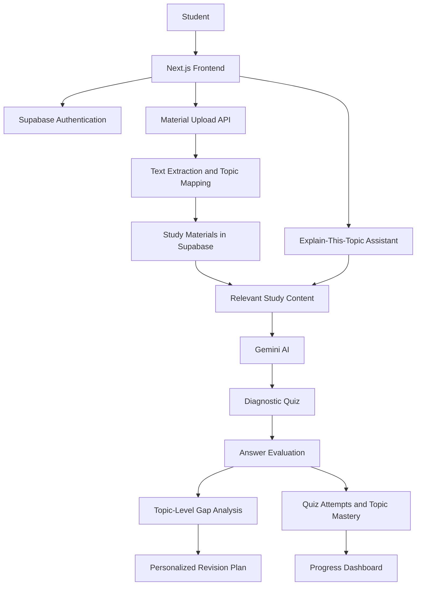

## System Architecture

## RAG Pipeline

GapFinder AI is designed to ground learning activities in a student's own study materials.

1. **Material ingestion:** Students upload supported study files through the application.
2. **Text extraction:** The materials API extracts content and identifies topics.
3. **Content preparation:** Extracted content and supporting evidence are prepared for AI processing.
4. **Retrieval and grounding:** Relevant topic information and available source passages are supplied to the AI workflow.
5. **Question generation:** The quiz API uses the supplied topic information and source passages to generate diagnostic questions.
6. **Evidence and evaluation:** Questions should be traceable to their source material, and submitted answers are evaluated to identify knowledge gaps.

**Implementation note:** The current implementation should be described according to the retrieval logic actually present in the code. Do not claim vector embeddings, a pgvector index, or semantic similarity search unless those components have been implemented and verified.

## AI Workflow

1. A student uploads study material.
2. The application extracts topics and supporting content.
3. The AI generates diagnostic questions using the available material context.
4. The student's answers are evaluated and a score is calculated.
5. Topic-level performance is used to classify areas as strong, developing, or weak.
6. A prioritized revision plan directs the student towards topics needing more attention.
7. Quiz attempts and topic mastery are saved so progress can be restored and reviewed.

## Technology Stack

- **Frontend:** Next.js, React, TypeScript, Tailwind CSS
- **Backend:** Next.js API routes
- **AI:** Google Gemini
- **Authentication and database:** Supabase
- **Deployment:** Vercel
- **Version control:** Git and GitHub

## Limitations

- Topic extraction and AI-generated questions may not perfectly represent every detail in a document.
- Diagnostic accuracy depends on the quality and coverage of the uploaded material and generated questions.
- Source citations and evidence should be checked for traceability to the original material.
- The revision plan is a learning aid and should be reviewed by the student.
- The current system focuses on individual learning; teacher-level class analytics are not yet part of the core workflow.

## Future Enhancements

- Semantic retrieval using embeddings and Supabase pgvector.
- More reliable source citations with document and section references.
- Explain-This-Topic assistant with evidence-backed answers.
- Adaptive revision scheduling and spaced-repetition reminders.
- Teacher dashboards and class-level performance analytics.
- Multi-subject and multilingual support.
- Learning management system (LMS) integration.
